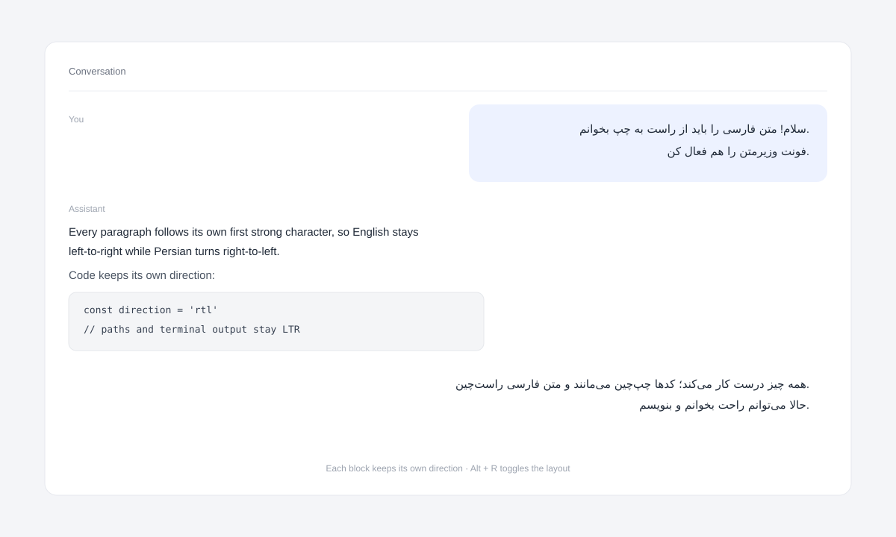

## What it does

DeepSeek Harness lays chat text out left-to-right. This bundle adds Persian and Arabic reading direction without disturbing English text or code:

- **Paragraphs that know their language.** A chat block that contains Persian or Arabic letters reads right-to-left — even when it opens with a Latin product name such as `DeepSeek` — while a block with no right-to-left letters stays left-to-right.
- **Lists and quotes that mirror.** A Persian list moves its markers and the 18 px gutter to the right, and a Persian blockquote moves its bar and padding to the right, so nothing hangs in the wrong margin.
- **A composer that follows you.** The draft's direction comes from its first strong character as you type: a Persian draft sits right-aligned, an English one left-aligned. An in-progress input-method composition is never interrupted.
- **Isolated code.** Fenced code blocks, inline code, keyboard glyphs, and math are pinned left-to-right inside right-to-left prose.
- **Bundled Vazirmatn.** The Vazirmatn variable font ships inside the bundle and loads offline. It leads the interface's text stack, and the font chosen in **Settings → General** stays in the stack behind it.
- **Force mode.** Right-aligns every chat block and the composer, including replies that contain no Persian letters at all — useful when an assistant answers a Persian question in English.
- **A panel in the header.** The bidirectional-text button beside the conversation header's More-actions control opens a small panel with the three switches, and the icon takes a tint while the layout is on. `Alt` + `R` toggles instantly from anywhere, including while the composer has focus.

## Usage

Open **Settings** (the gear beside the sidebar foot) and choose **Persian RTL**. The section has three switches:

| Switch | Effect |
| :--- | :--- |
| Right-to-left layout | Turns the direction resolver on or off; `Alt` + `R` and the header button do the same. |
| Force right-to-left | Right-aligns every chat block and the composer. Available while the layout is on. |
| Vazirmatn font | Puts the bundled font in front of the interface's text font. |

The header button opens the same three switches without leaving the conversation: click it, flip a switch, and click anywhere else or press Escape to dismiss. The panel is a frame-level overlay, so the header never clips it.

The button lives in the Session header's utilities row, which a blank New Session hides together with its More-actions control. On that screen use `Alt` + `R` or this settings page.

The preview under the switches runs the current rules over a Persian paragraph, a Persian paragraph that opens with a Latin word, an English paragraph, and one code line, so the effect of each switch is visible without leaving the page. With the layout off, the preview shows the plain left-to-right result.

Type size, line height, and your own font choice stay where they already live: **Settings → General**. This page only decides direction and whether Vazirmatn leads that font stack.

## What stays left-to-right

Code blocks, inline code, keyboard glyphs, and math. A right-to-left paragraph that quotes `inline code` keeps the quote itself left-to-right and lets the sentence flow around it. File chips, links, and other inline elements follow the paragraph they sit in.

## Limitations

- The plugin styles the Web client, which is also the window the Desktop app shows. Native menus and dialogs outside the page are not affected.
- Preferences are stored per browser origin in `localStorage` (`dsh.persian-rtl.v1`); they are not part of the Host settings document. Clearing site data resets them to on / off / on.
- The paragraph rule is "contains a right-to-left letter", so an English paragraph that quotes one Persian word is right-aligned as well.
- `Alt` + `R` is handled by the plugin itself, so it does not appear in **Settings → Keyboard shortcuts**, and another binding cannot be recorded for it.
- The Vazirmatn font, its license, and this bundle's source ship with the package; the font is distributed under the SIL Open Font License (see `assets/OFL.txt`).
